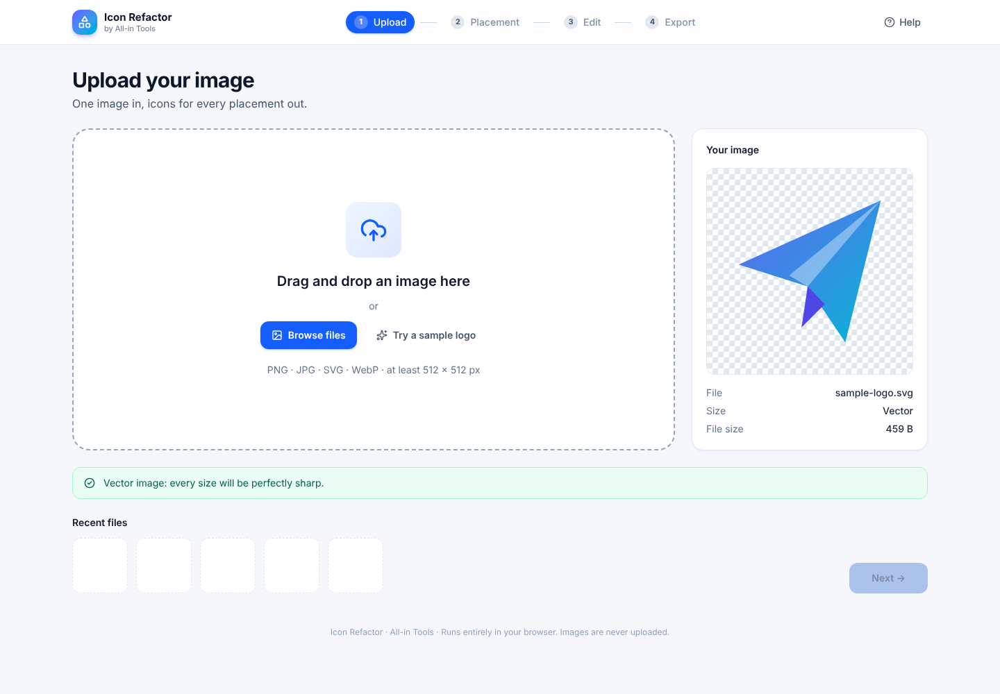
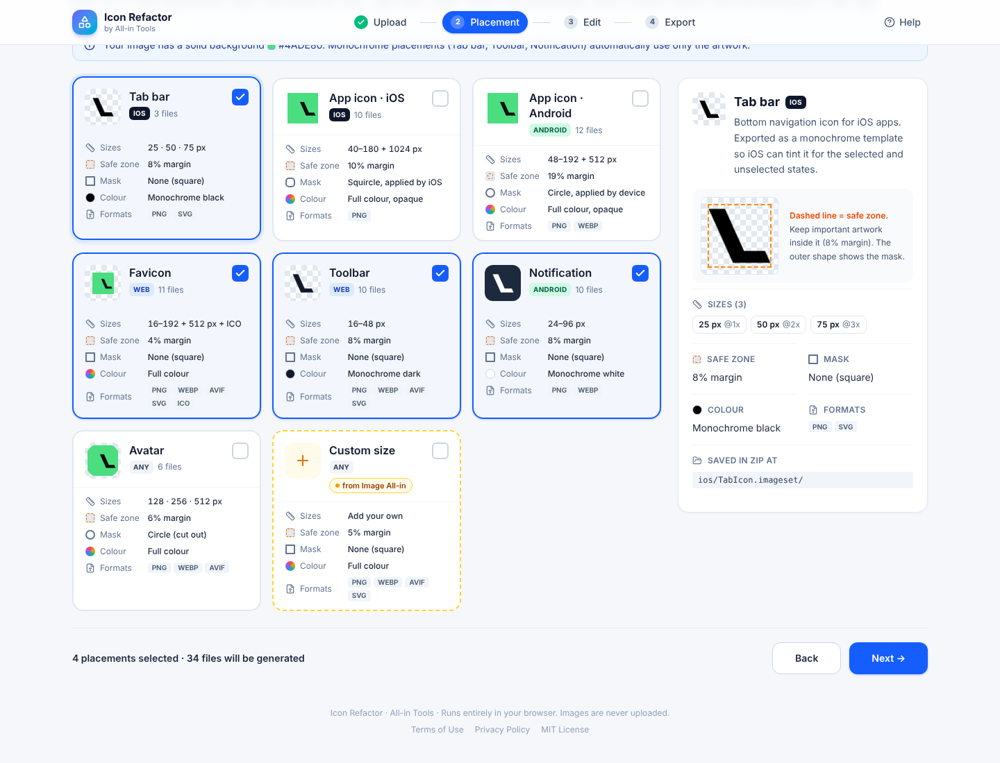
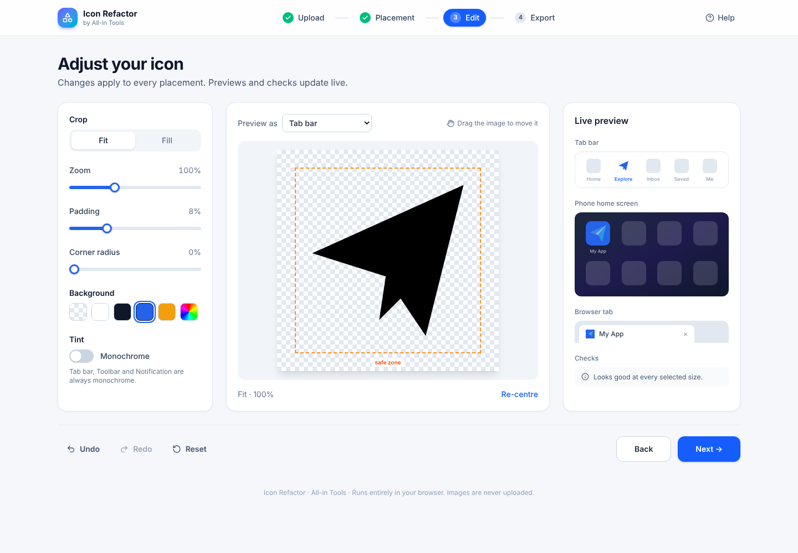
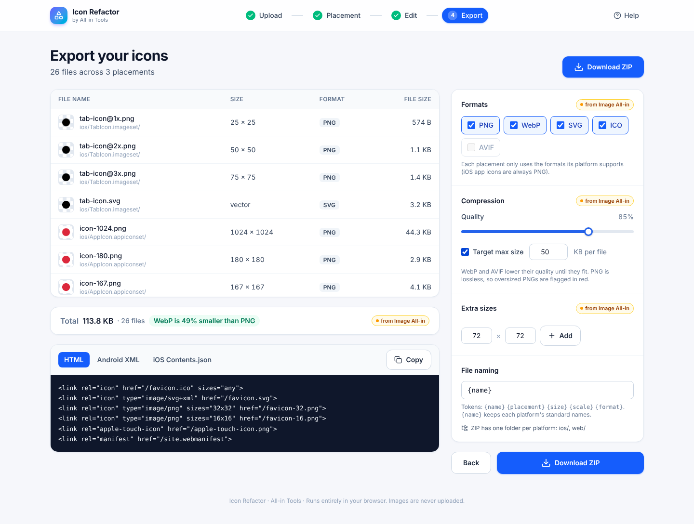

# Icon Refactor

**One image in, icons for every placement out.**

Icon Refactor turns a single logo or image into ready-to-use icons for iOS tab bars, iOS and Android app icons, favicons, toolbars, notifications and avatars. Each placement knows its own sizes, safe zone and rules. It also includes three features from the **Image All-in** proposal: **format convert**, **compression** and **custom sizes**.

Everything runs in the browser. Images are never uploaded to a server.

Part of the **All-in Tools** project.

| Upload | Placement |
| --- | --- |
|  |  |
| **Edit** | **Export** |
|  |  |

---

## Features

| Step | What you can do |
| --- | --- |
| **1 · Upload** | Drag and drop or browse for a PNG, JPG, SVG or WebP. It warns you if the image is too small (under 512 px) or not square. You can reopen recent files or try a sample logo. |
| **2 · Placement** | Pick one or more of 7 presets plus **Custom size**. Each card previews your icon. The side panel shows that preset's sizes, safe zone, mask, colour rule and formats. |
| **3 · Edit** | Fit or fill, zoom, drag to move, padding, corner radius, background colour and monochrome tint. You get live previews in a tab bar, a phone home screen and a browser tab, plus automatic checks (upscaling, no transparency, thin lines, low contrast). Undo, redo and reset are available. |
| **4 · Export** | Pick formats (PNG, WebP, SVG, ICO, AVIF) and a compression quality, and optionally set a **target max KB per file**. Add extra sizes and choose a file-naming pattern. The table lists every output file, and a size report shows the savings. You get code snippets for **HTML, Android XML and iOS Contents.json**, and **Download ZIP** gives you one folder per platform. |

Features tagged **from Image All-in** in the UI come from the Image All-in proposal.

## Quick start

Requirements: Node.js 20 or newer, and npm.

```bash
npm install
```

```bash
npm run dev
```

Open http://localhost:3000.

Production build:

```bash
npm run build
```

```bash
npm start
```

| Script | What it does |
| --- | --- |
| `npm run dev` | Start the dev server with hot reload |
| `npm run build` | Create a production build (static page) |
| `npm start` | Serve the production build on port 3000 |
| `npm run lint` | Run ESLint |

> AVIF export is enabled automatically in browsers that can encode AVIF from a canvas (most cannot yet).

### Deploy

The app is one static page with no server code or environment variables. To deploy, import the repository into Vercel (or any Next.js host) and use the default settings.

## Project structure

```
src/
  app/
    page.tsx            Wizard state: steps, selection, edit history, export settings
    layout.tsx          HTML shell and metadata
    globals.css         Tailwind and a few custom styles (slider, squircle)
  components/
    Header.tsx          Logo, step indicator, help panel
    IconImage.tsx       Renders an icon exactly as it will be exported
    ui.tsx              Buttons, cards, sliders, toggles, "from Image All-in" tag
    steps/
      UploadStep.tsx
      PlacementStep.tsx
      EditStep.tsx
      ExportStep.tsx
  lib/                  Framework-free core (no React). This is the future npm library.
    types.ts            Shared types
    presets.ts          Placement presets: sizes, safe zones, rules, output paths
    render.ts           Image loading, drawing and quality checks
    encode.ts           PNG/WebP/AVIF encoding, target-size search, ICO packing
    export.ts           File plan, generation, code snippets, ZIP
public/samples/         Sample logo used by "Try a sample logo"
docs/                   Documentation (see below)
```

## Documentation

- [User guide](docs/USER_GUIDE.md): how to use each screen
- [Presets](docs/PRESETS.md): every placement, size and output path
- [Architecture](docs/ARCHITECTURE.md): how processing works and how the core becomes a library
- [Demo script](docs/DEMO_SCRIPT.md): a 5-minute walkthrough for presenting the tool
- [Security review](docs/SECURITY_REVIEW.md): the pre-release security, privacy and legal checklist

## Security, privacy and legal

- Images are processed **only in your browser**. There are no uploads, cookies, analytics or third-party requests.
- Strict security headers (CSP and others) are set in `next.config.ts`.
- `npm audit`: 0 known vulnerabilities.
- Pages: [Terms of Use](src/app/terms/page.tsx) (`/terms`) · [Privacy Policy](src/app/privacy/page.tsx) (`/privacy`)
- [SECURITY.md](SECURITY.md) · [Security review](docs/SECURITY_REVIEW.md) · [LICENSE](LICENSE) (MIT) · [Third-party notices](THIRD_PARTY_NOTICES.md)

## Tech stack

Next.js 15 (App Router) · React 19 · TypeScript · Tailwind CSS 4 · Canvas 2D API · JSZip · lucide-react

## Roadmap

The plan is web app first; the library comes later.

1. Move `src/lib` into an npm package (`@all-in-tools/icon-refactor-core`).
2. Publish the editor as a React component (`<IconEditor/>`).
3. Add a CLI (`npx icon-refactor logo.svg --preset ios,favicon`) that uses `sharp` in Node.
4. Add Android adaptive icon layers (foreground/background XML), a dark-mode icon variant and a PDF for Xcode.
